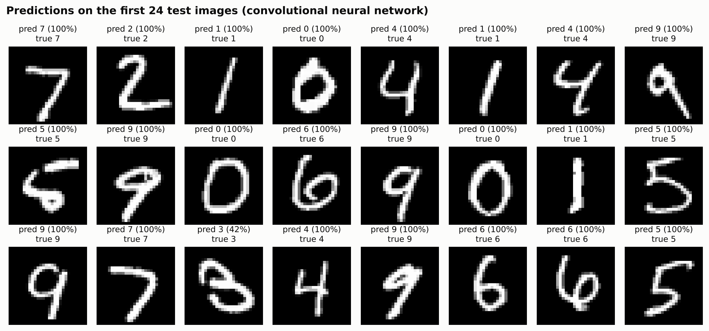
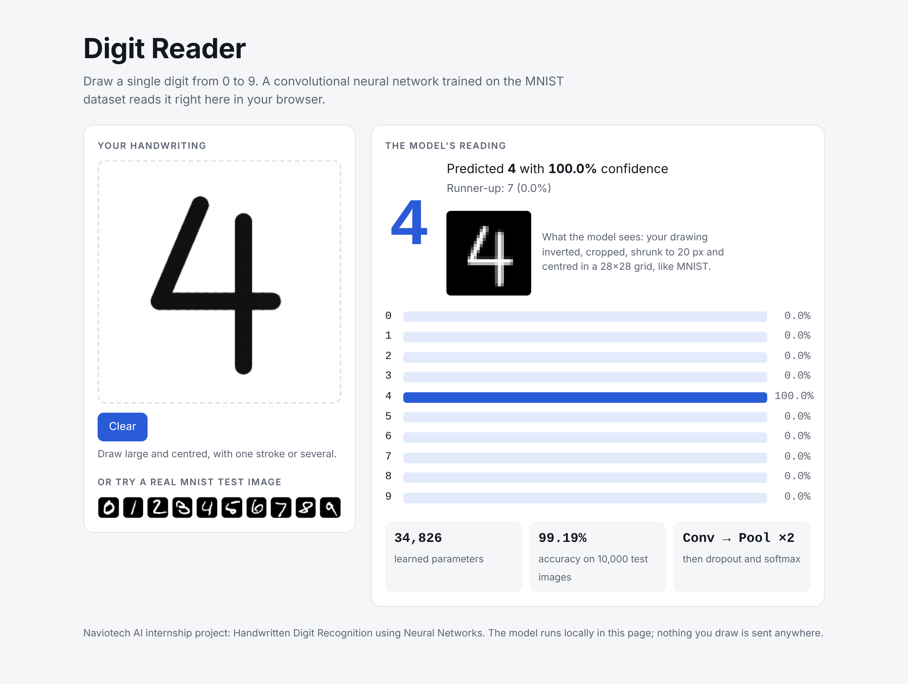
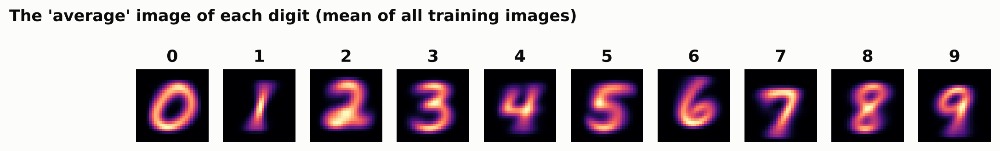
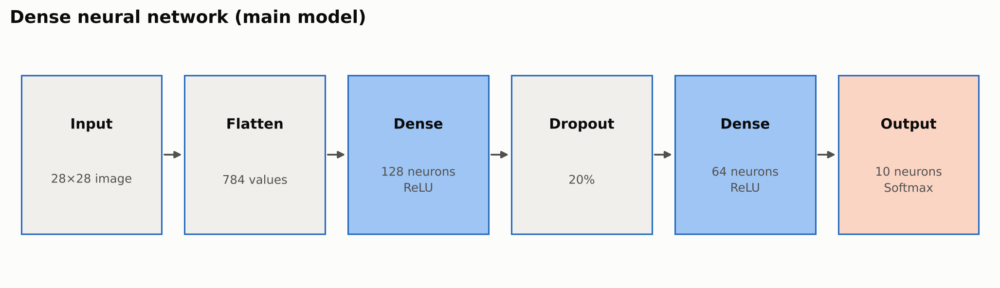
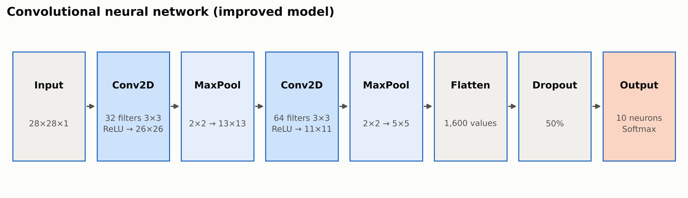
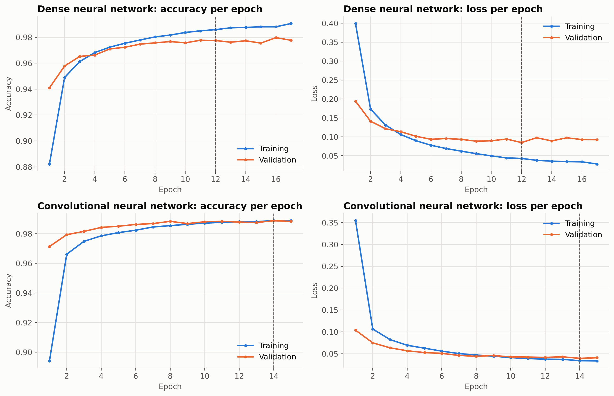
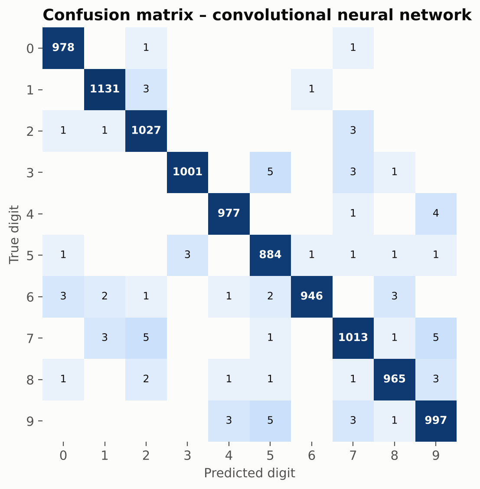
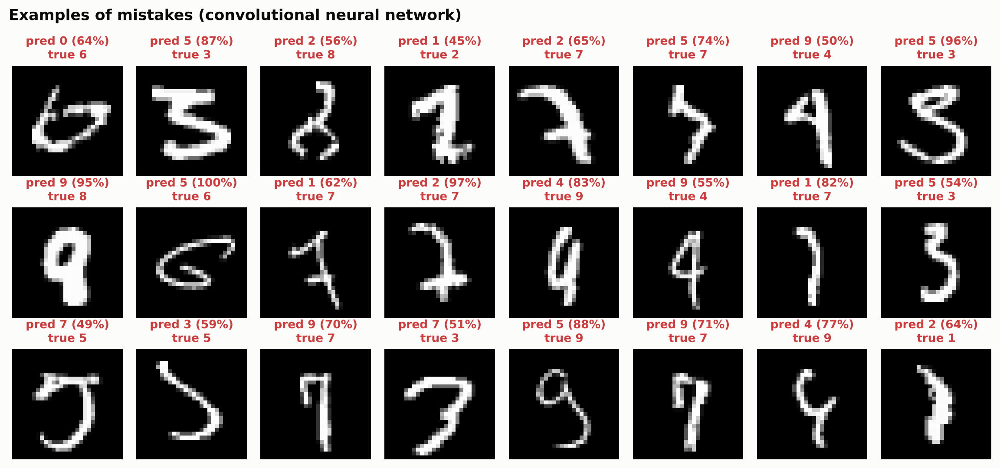

# Handwritten Digit Recognition using Neural Networks (MNIST)

[](https://www.python.org/)
[](https://www.tensorflow.org/)
[](https://colab.research.google.com/github/sangini-agrawal/mnist-digit-classification-nn/blob/main/notebooks/MNIST_Digit_Classification_NN.ipynb)

Neural networks built with **TensorFlow / Keras** that recognise handwritten digits (0–9) from the **MNIST** dataset, plus a prediction system that reads your own handwriting: draw on screen, upload a photo, or use the browser demo.

> **Internship project** – Naviotech Solution, Artificial Intelligence Domain, September 2026 batch.
> **Author:** Sangini Agrawal

---

## Results at a glance (10,000 unseen test images)

| Model | Parameters | Test accuracy | Macro F1 | Errors |
|---|---|---|---|---|
| **Dense neural network** (main model) | 109,386 | **97.93%** | 97.91% | 207 |
| **Convolutional neural network** (improved) | 34,826 | **99.19%** | 99.18% | 81 |

Target from the project guide: **> 95%**. Both models exceed it. All results are from my own run in Google Colab.

<p align="center"></p>

---

## Project structure

```
mnist-digit-classification-nn/
├── notebooks/MNIST_Digit_Classification_NN.ipynb   # full walkthrough – run in Google Colab
├── src/
│   ├── config.py        # paths and hyper-parameters
│   ├── data.py          # load, normalise, train/validation split
│   ├── model.py         # dense network and CNN
│   ├── evaluate.py      # metrics and classical baselines
│   ├── visualize.py     # all charts
│   ├── preprocess.py    # turns a user's photo/drawing into an MNIST-style 28×28 input
│   ├── train.py         # end-to-end training pipeline
│   ├── predict.py       # command-line digit recogniser
│   ├── photo_test.py    # tests the preprocessing on photo-style images
│   └── export_web.py    # exports the CNN for the browser demo
├── web_demo/            # index.html – draw a digit, the CNN reads it in the browser
├── sample_digits/       # drawn, photographed and starter test images
├── models/              # saved .keras models (created when you train)
├── results/             # figures/, metrics.json
├── screenshots/         # my Colab outputs: dataset, training, accuracy, predictions
├── docs/                # project report, synopsis, abstract, presentation
├── requirements.txt · LICENSE · README.md
```

---

## How to run

### Option A – Google Colab (recommended)
1. Click **Open in Colab** above (or upload the notebook at [colab.research.google.com](https://colab.research.google.com)).
2. Optional: **Runtime → Change runtime type → T4 GPU** to train the CNN faster.
3. **Runtime → Run all.** MNIST downloads automatically. At the end, **draw a digit** in the canvas or **upload a photo** of one.

### Option B – Run locally
```bash
git clone https://github.com/sangini-agrawal/mnist-digit-classification-nn.git
cd mnist-digit-classification-nn
python -m venv venv && source venv/bin/activate        # Windows: venv\Scripts\activate
pip install -r requirements.txt

python -m src.train                          # trains both networks + baselines, saves models and charts
python -m src.predict                        # reads every image in sample_digits/
python -m src.predict --image my_digit.jpg   # your own photo or drawing
python -m src.photo_test                     # plain resize vs MNIST-style preprocessing on 30 photo-style images
python -m src.export_web                     # refresh the browser demo with your trained CNN
```

### Option C – Browser demo
Open `web_demo/index.html` in any browser, draw a digit and see the prediction instantly. It uses the CNN I trained in Colab, needs no installation and works offline.

<p align="center"></p>

---

## Dataset

| Property | Value |
|---|---|
| Name | MNIST handwritten digits (LeCun, Cortes & Burges) – loaded with `keras.datasets.mnist` |
| Images | 70,000 grayscale, 28 × 28 pixels, white digit on black |
| Split used | 54,000 training · 6,000 validation (stratified from the training set) · 10,000 test |
| Classes | 10 digits, roughly balanced (5,421 – 6,742 training images each) |

<p align="center"></p>

---

## Methodology

| Phase | Work done |
|---|---|
| 1 · Data collection | Load MNIST, inspect shapes, pixel values, sample images, class balance, average digit images |
| 2 · Preprocessing | Scale pixels 0–255 → 0–1; hold out 6,000 validation images; add channel axis for the CNN |
| 3 · Model development | Dense network 784 → 128 → 64 → 10 (ReLU, dropout 0.2, softmax); CNN with two Conv–Pool blocks |
| 4 · Training | Adam (lr 0.001), sparse categorical cross-entropy, batch 128, early stopping on validation loss |
| 5 · Evaluation | Accuracy, macro precision / recall / F1, per-digit accuracy, confusion matrices, error analysis, 3 classical baselines |
| 6 · Prediction | MNIST-style preprocessing of user images; Colab drawing canvas and upload; CLI; browser demo |

<p align="center"><br></p>

**Design decisions**
- **Softmax output** (the starter code used sigmoid): ten probabilities that sum to 1, the correct pairing with categorical cross-entropy.
- **Separate validation set** instead of validating on the test set, so the 10,000 test images give a fair score.
- **Early stopping** with best-weight restore prevents over-fitting automatically.
- **MNIST-style preprocessing for user input** (invert, remove paper background, crop, fit in 20×20, centre by mass in 28×28). With it, the CNN reads all 11 images in `sample_digits/` correctly. On 30 harder photo-style images (small, off-centre digits on grey, noisy paper) it gets **16/30** right, against **4/30** for the starter code's plain resize. Very small, faint digits are still a weak point.

---

## Results

<p align="center"></p>

| | Dense network | CNN |
|---|---|---|
| Epochs trained (best epoch) | 17 (12) | 15 (14) |
| Test accuracy | 97.93% | 99.19% |
| Macro precision / recall | 97.92% / 97.91% | 99.19% / 99.18% |
| Hardest digit | 9 (96.8%) | 7 (98.5%) |
| Most common confusion | 4 → 9 (14×) | 9 → 5, 7 → 9, 7 → 2, 3 → 5 (5× each) |

<p align="center"></p>

### Comparison with classical machine learning

| Model | Test accuracy |
|---|---|
| **Convolutional neural network** | **99.19%** |
| **Dense neural network** | **97.93%** |
| K-Nearest Neighbours (k=3) | 96.99% |
| Random Forest (100 trees) | 96.96% |
| Logistic Regression | 92.45% |

<p align="center"></p>

## Key findings
- Both networks beat the 95% target. The CNN makes less than half the mistakes of the dense network (81 vs 207) with **3× fewer parameters**, because convolutions learn local strokes and shapes wherever they appear.
- Most remaining errors are on digits that look alike or are written unusually (4 ↔ 9, 7 ↔ 2, 9 ↔ 5).
- The CNN's confidence is useful: 93.5% of test images get ≥ 99% confidence, and those are right 99.97% of the time, while 80% of its mistakes have confidence below 90%.
- Real-world input needs MNIST-style preprocessing; a plain resize fails on small or off-centre digits.

## Limitations
Single, centred digits only · MNIST writers are mostly American, so other handwriting styles may be harder · no rejection of non-digit input · small, faint digits in noisy photos are often misread.

## Future scope
Data augmentation (rotations, shifts, elastic distortions) · deeper CNNs with batch normalisation · multi-digit and full-number recognition · confidence threshold to reject unclear input · EMNIST letters · mobile app with TensorFlow Lite.

## Applications
Bank cheque processing · postal code recognition · OCR systems · educational tools · automated form processing.

---

## Tech stack
Python · TensorFlow / Keras · NumPy · Pandas · Matplotlib · scikit-learn · Pillow · Jupyter / Google Colab · HTML/JavaScript (browser demo)

## References
1. Y. LeCun, L. Bottou, Y. Bengio, P. Haffner, "Gradient-based learning applied to document recognition," *Proc. IEEE*, 86(11), 1998.
2. Y. LeCun, C. Cortes, C. J. C. Burges, *The MNIST database of handwritten digits*.
3. D. P. Kingma, J. Ba, "Adam: A method for stochastic optimization," ICLR 2015.
4. N. Srivastava et al., "Dropout: A simple way to prevent neural networks from overfitting," *JMLR* 15, 2014.
5. F. Chollet et al., *Keras*, https://keras.io

## Acknowledgement
Developed as part of the Artificial Intelligence internship at **Naviotech Solution**. `sample_digits/starter_3.png` comes from the Naviotech starter material.

## License
[MIT](LICENSE)
